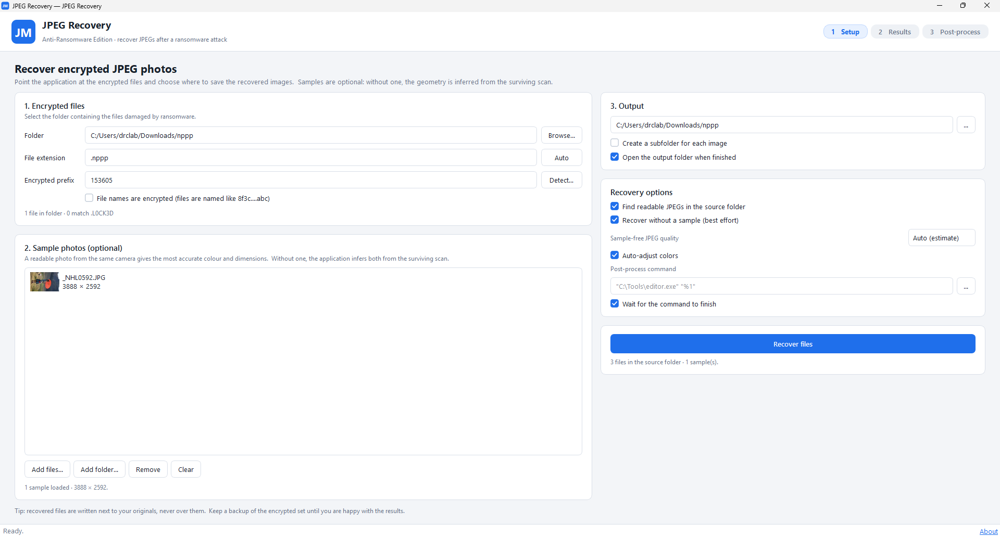
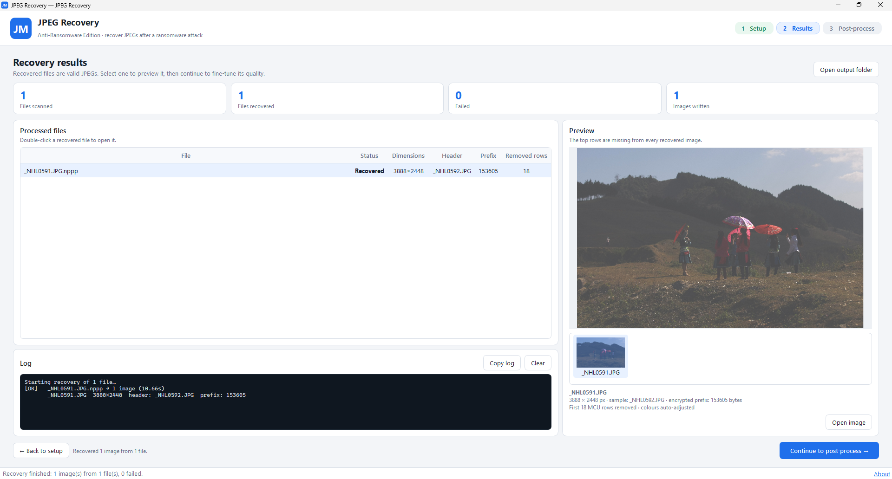
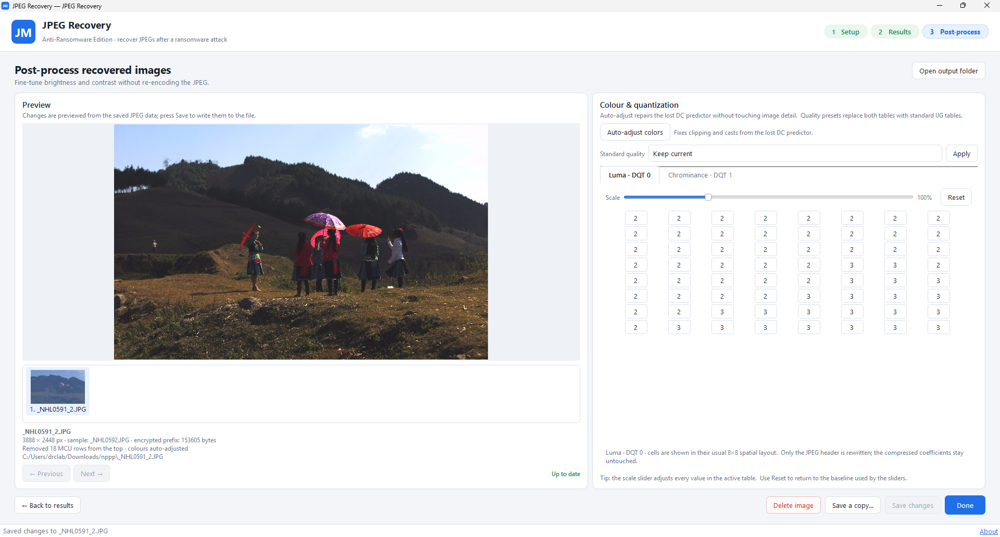

# JPEG Recovery

An independent, functional reimplementation of the original Anti-Ransomware
Edition workflow. It rebuilds JPEG files whose headers and first part of the
compressed scan were destroyed by ransomware.

A readable photo from the same camera is recommended for exact dimensions,
tables, and colour, but it is **not required**. Without a sample,
infers the sampling layout and MCU row width directly from the surviving scan
and rebuilds the image with standard JPEG tables.

The application is a real recovery tool, not a mockup: it parses JPEG markers,
searches the surviving entropy data for a valid MCU boundary, rebuilds a fresh
JPEG header, and optionally lets you tune the quantization tables without
re-encoding the image.

> This project is not affiliated with, endorsed by, or licensed from the
> original product. It contains no original logos, artwork, or
> registration code.

## Features

- Three-step workflow: **Setup → Results → Post-process**.
- Batch recovery with progress, cancel, per-file status, and a log.
- **Sample-free recovery** using standard Annex K Huffman tables, automatic
  sampling-layout detection, and row-width inference from luma DC correlation.
- Optional reference samples can be JPEG files or JPEG previews embedded in RAW
  files; when present, they take priority over inference.
- Automatic encrypted-extension and prefix-size detection, plus readable JPEG
  discovery directly in the damaged folder.
- Supports baseline and extended-sequential Huffman JPEGs, including scans with
  restart markers (DRI) through the sample-based path.
- Selectable sample-free JPEG quality (auto-estimated or fixed).
- Recovered-image previews and thumbnails.
- **Auto-adjust colors** repairs the additive brightness/colour cast caused by the
  destroyed first DC predictor. It rewrites only DC differences, so detail,
  quantization tables, and restart markers are preserved. Available during
  recovery and from the Post-process page.
- Quantization-table editor with 8×8 grid, live preview, scale sliders, reset,
  save, save-copy, and delete.
- Standard IJG quality presets (q60–q100) that visibly change brightness,
  contrast, and colour rendition without re-encoding the scan. q100 uses
  near-lossless tables and is the better default when the photo has fine
  detail; the file will be larger.
- Optional post-process command (`%1` is replaced by the recovered file path).
- Settings and window layout persist between sessions.

## Requirements

- Windows 10/11 (the UI is developed and tested there; the core is portable).
- Python 3.10 or newer.
- PyQt6, Pillow, and numpy (numpy is used by the recovery engine for geometry
  inference).

## Install and run

```bat
python -m pip install -r requirements.txt
python main.py
```

Or double-click `run.bat`, which installs missing packages and launches the
application.

## Try the demo

The repository includes synthetic demo data in `demo/encrypted`:

- `sample.jpg` — an optional readable donor photo.
- `beach.jpg.abc`, `forest.jpg.abc`, `harbour.jpg.abc`, `mountains.jpg.abc` —
  JPEGs whose first 8192 bytes were replaced with random data.

Start the app and use:

| Field | Value |
| --- | --- |
| Encrypted folder | `demo\encrypted` |
| File extension | `.abc` |
| Encrypted prefix | `8192` |
| Output folder | `demo\recovered` |

**Sample-free demo:** clear the sample list, turn off **Find readable JPEGs in
the source folder**, keep **Recover without a sample** enabled, and press
**Recover files**. The four JPEGs are recovered with inferred 4:2:0 geometry and
an estimated quality of 100 (near-lossless).

**Sample-based demo:** leave the sample list empty and turn on **Find readable
JPEGs in the source folder**; the app picks up `sample.jpg` automatically. Both
paths produce the same recovered pixels for this demo set.

The demo files have no restart markers, so their recovered colours can carry the
lost-DC offset. Open **Post-process** and press **Auto-adjust colors** to repair
it, or try a standard quality preset.

To regenerate the synthetic demo files (and reset any recovered output):

```bat
python tools/make_demo.py
```

## Screenshots

| Setup | Results |
| --- | --- |
|  |  |

| Post-process and colour repair |
| --- |
|  |

These images are produced by the UI smoke test on the synthetic demo batch.

## Using your own files

1. Choose the folder containing the damaged files.
2. Enter the extension appended by the ransomware (for example `.abc`, `.enc`,
   or leave it empty if names were not changed).
3. Enter the number of encrypted bytes at the start of each file. **Detect…**
   tries common sizes against loaded samples; without a sample, leave the field
   on **Auto** or enter the size manually.
4. Optionally add 1–5 readable photos from the same camera model and
   resolution, or put them in the source folder and enable automatic discovery.
5. Choose an output folder and press **Recover files**. With no sample,
   **Recover without a sample** is used automatically.
6. Review the results. Continue to **Post-process** to repair colours with
   **Auto-adjust colors**, or to adjust brightness, contrast, and colour
   rendition with the quantization-table editor and standard quality presets.

Recovered files are written with unique names and never replace the encrypted
originals or existing recovered files.

## How recovery works

JPEG scans are a bit stream of MCUs (minimum coded units). If the first part of
a file is encrypted, the entropy data that follows is often still intact. The
recovery engine:

1. **Sample-based path:** parses a readable photo to obtain the frame
   dimensions, sampling factors, quantization tables, and Huffman tables.
2. **Sample-free path:** uses the standard Annex K Huffman tables, tests the
   common 4:2:0, 4:2:2, 4:4:4, grayscale, 4:1:1, and 4:4:0 layouts, and finds a
   bit alignment that decodes as a complete MCU stream.
3. Searches the surviving data after the encrypted prefix for a byte/bit offset
   that decodes as valid MCUs.
4. Infers the MCU row width when no sample is available. Luma DC values separated
   by the true row width are vertically adjacent and therefore strongly
   correlated; neighbouring lags are measurably weaker.
5. Advances to the next MCU-row boundary so the rebuilt image is not shifted
   horizontally. The remaining MCU count modulo the row width gives the exact
   offset to the next row boundary.
6. Estimates the lost quantization quality from the compressed bit rate (or
   uses the quality selected in the UI), removes JPEG byte stuffing, and
   re-wraps the surviving entropy data in a fresh SOI/DQT/SOF/DHT/SOS header,
   cropping the height to the rows that remain.
7. Validates the result by decoding it with Pillow before writing it.
8. Optionally applies lossless DC colour correction and runs the configured
   post-process command.

Because JPEG stores DC values differentially, losing the first DC predictor
shifts every later DC value in the scan by a constant. That is an additive
brightness/colour offset, not damaged detail. **Auto-adjust colors** measures the
displayed Y/Cb/Cr means, iterates a small DC shift, and rewrites only the first
DC difference of each component in each restart interval. Quantization tables,
Huffman tables, AC coefficients, and all following differences stay
byte-identical. The correction is reversible and preserves restart markers.

If the scan contains restart markers, the sample-based path uses the first
restart marker after the encrypted prefix as a byte-aligned synchronization
point and preserves the restart interval in the rebuilt header.

## Supported files and limitations

- **Sample-free recovery is best-effort.** It assumes the file uses standard
  JPEG Huffman tables (libjpeg, Pillow, and most encoders do). Camera-optimised
  DHT tables need a sample from the same camera.
- The quantization tables are lost with the header. Sample-free mode estimates
  a standard quality level from the compressed bit rate; this affects
  brightness/contrast, not geometry. Choose a fixed quality in the UI if the
  automatic estimate looks wrong. A sample gives exact tables.
- Sample-free output widths are rounded up to a whole MCU (8 or 16 pixels,
  depending on sampling). A sample recovers the exact original dimensions.
- The sample-free path defaults to quality 100 (near-lossless) so detailed
  photos do not show the blocking grids that 95% can still produce. The
  estimate from the compressed bit rate is still available as an option, and
  the user can choose any standard quality from 60 to 100.
- Scans with restart markers are fully supported by the sample-based path. The
  sample-free path generally needs a sample when restart intervals and MCU rows
  do not line up.
- Baseline and extended-sequential **interleaved Huffman** JPEGs are supported.
  Progressive, arithmetic-coded, lossless, and hierarchical JPEGs are rejected
  with a clear message. RAW samples work through their embedded JPEG preview.
- The encrypted prefix must be a contiguous block at the start of the file.
  The rest of the scan must be structurally intact.
- The encrypted rows are gone. Every recovered image is shorter than the
  original, and the missing top rows cannot be restored. EXIF/ICC metadata from
  the destroyed header is also lost; recovered files use a minimal JFIF header.
- Because the DC predictor from the lost rows is unknown, a non-restart JPEG can
  have a uniform colour/brightness shift. **Auto-adjust colors** repairs this
  losslessly, including the heavy black clipping seen on some cameras, by
  shifting DC values. Detail that was already clipped to pure black cannot be
  invented, and auto-adjust targets a neutral, mid-brightness photograph rather
  than restoring the exact original exposure. Restart-marker JPEGs usually need
  no correction because restart markers reset the predictor.
- Exact quantization tables cannot be recovered from a scan. The quality
  presets and table editor change how the existing coefficients are rendered,
  but they cannot recreate information that was never encoded.
- Recovery is best-effort. Heavily fragmented, truncated, re-encoded, or
  multiply-encrypted files may produce no usable result.

## Tests

```bat
python -m unittest discover -s tests -v
```

The suite generates its own JPEG fixtures and covers sample-based recovery,
sample-free recovery (including 4:4:4 and false-layout rejection), disabling
sample-free mode, quantization-table replacement and standard quality presets,
lossless DC colour correction (including pixel-exact reversal), automatic colour
balancing on normal and restart-marker scans, scan replacement, naming/extension
detection, automatic prefix selection, and restart-marker (DRI) recovery.

The UI smoke test opens the real window, runs a complete demo batch, exercises
the table editor, a standard quality preset, and **Auto-adjust colors**, then
writes screenshots to `tools/ui_shots`:

```bat
python tools/ui_smoke.py
```

It should be run on an interactive Windows desktop so the screenshots capture
the rendered window. Generate the demo data first if `demo/encrypted` is
missing.

## Build a standalone executable

`build_exe.bat` installs PyInstaller if needed and creates a windowed EXE:

```bat
build_exe.bat
```

The result is written to `dist\JPEG-Recovery.exe`.

## Project layout

```text
main.py                     Application entry point
jpegmedic/core/jpeg.py      JPEG marker parser and header builder
jpegmedic/core/scan.py      MCU boundary search, entropy handling, bit shifting
jpegmedic/core/sampleless.py Sample-free tables, layout and width inference
jpegmedic/core/colorfix.py  Lossless DC colour correction and auto-adjust
jpegmedic/core/recovery.py Batch orchestration, naming, prefix candidates
jpegmedic/core/samples.py   JPEG/RAW sample loading
jpegmedic/ui/               PyQt6 pages, worker thread, theme, widgets
tests/test_core.py          Core unit tests
tools/make_demo.py          Synthetic demo generator
tools/ui_smoke.py           End-to-end UI smoke test and screenshots
demo/                       Safe synthetic demo data
```
## Citation & Research

If you use or reference this work, please cite the research publication:

* **ResearchGate:** [Recovering Damaged Baseline JPEGs Without a Donor Header](https://www.researchgate.net/publication/417055954_Recovering_Damaged_Baseline_JPEGs_Without_a_Donor_Header)

[](https://www.researchgate.net/publication/417055954_Recovering_Damaged_Baseline_JPEGs_Without_a_Donor_Header)
